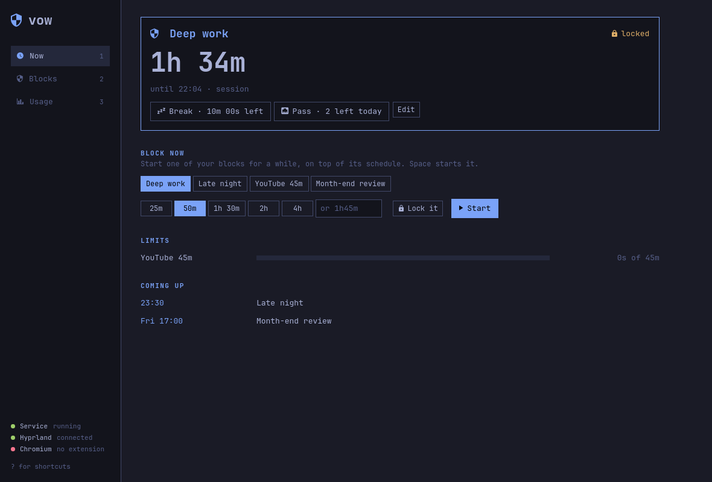

# Vow



Vow blocks websites and apps on schedules as precise as you want them, for
Omarchy. It is a Cold Turkey–style blocker (lists, locks you cannot undo)
and a Micromanager-style limiter (time budgets per hour, day, or week) in
one. A root service enforces everything, so closing the window never ends a
block.

## Install

```sh
omarchy pkg aur add vow            # from the AUR
sudo systemctl enable --now vow     # starts the enforcing service
vow setup                           # Chromium extension + bar widget, as yourself
```

Or build from this repo:

```sh
bin/install                         # builds and installs the package
sudo systemctl enable --now vow     # starts the enforcing service
vow setup                           # Chromium extension + bar widget, as yourself
```

Restart Chromium after `vow setup` so it loads the extension.

## Blocks

A block is a list of **websites** and **apps** plus **when** it applies.

- **Websites**: `reddit.com` covers every subdomain, `youtube.com/shorts`
  blocks only that path, `*` is the whole web. **Exceptions** let a URL
  through while the block is on (`youtube.com/watch?v=…`).
- **Apps**: a process name (`steam`), or a Hyprland window class
  (`class:discord`). Processes get SIGTERM, then SIGKILL; windows are closed.
- **Allow only**: flips the lists. Everything else is blocked: every site
  but the ones listed, every window but the apps listed.

Several blocks can be on at once. A URL is blocked if any active block names
it, or if any active allow-only block leaves it out.

## Scheduling

Rules add up; a block is on whenever any rule is. Each rule has a time
window to the minute, and a window whose end is before its start runs past
midnight (`22:00–06:15`).

| Rule | Examples |
|------|----------|
| Weekly | Mon–Fri 08:30–12:00 · every 2nd week from an anchor date |
| Daily | every day 23:30–06:00 · every 3 days |
| Monthly | last Friday 17:00–22:00 · 1st and 3rd Tuesday · days 1, 15, and -1 (last day) |
| One-off | 24 Dec 14:00 → 26 Dec 09:00 |

Any rule can be narrowed to some **months** and to a **date range**. On top
of rules a block has:

- **Days off**: holidays the schedule skips, cut at midnight.
- **Triggers**: *on login* blocks the first N minutes of each session.
- **Conditions**: *only on* / *except on* given Wi-Fi networks.
- **Time limit**: N minutes per hour, day, or week of focused time on the
  block's sites and apps, then blocked until the period ends. Rules set when
  the limit counts; with no rules it counts all the time.
- **Allowances**: breaks (N minutes per M minutes) and passes (N a day,
  M minutes each). They are part of the block, so they work while it is
  locked.
- **Sessions**: start any block now for a while, on top of its schedule.

The editor shows the next 14 days as a timeline, so you see what the rules
add up to before saving.

## Locks

A lock is a timer. Until it runs out, the service refuses anything that
would loosen the block: deleting, disabling, removing sites, apps, or rules,
changing a rule, adding exceptions, or shortening the lock. Adding sites,
apps, rules, or extending the lock still works. There is no early unlock.

Lock conditions are a list in the block (`lock.conditions`), all of which
must be met. Today only `timer` exists; a condition type the service does
not know keeps the block locked, so task-based unlocking (XP on Math
Academy, say) can be added without weakening existing locks.

You have root, so `sudo systemctl stop vow` ends everything. Vow does not
try to stop you from doing that.

## How it enforces

- `/etc/hosts`: blocked domains (with `www.` and `m.`) go to `0.0.0.0`, in a
  marked section the service owns.
- Chromium policy: `/etc/chromium/policies/managed/vow.json` gets
  `URLBlocklist`/`URLAllowlist`, which covers paths and allow-only mode.
- Chromium extension: reports open tabs to the service on
  `127.0.0.1:47321`, sends blocked tabs to a page in your theme that counts
  down and goes back when the block ends, and tells the service which site is
  in front, for limits and usage.
- Hyprland: the focused window is counted for usage and limits; blocked
  window classes are closed.

When the service stops it removes its hosts section and Chromium policy.

## Bar

`vow setup` installs the `vow.status` widget in the bar's centre. It shows
the active block's countdown and opens Vow on click; the tooltip lists what
is blocking and what is next.

## Command line

```text
vow                          open the window
vow status [--json]          what is blocking now and what comes next
vow list [--json]            every block
vow start <block> 90m [--lock]
vow stop <block>
vow lock <block> 7d          or until 2026-12-24T18:00
vow break <block>
vow pass <block>
vow setup
vow daemon                   (systemd runs this)
```

## Shortcuts

| Key | Action |
|-----|--------|
| `1` `2` `3` | Now, Blocks, Usage |
| `Space` | Start the quick block |
| `N` | New block |
| `Ctrl+S` | Save the block |
| `Esc` | Leave a field, close overlays |
| `?` | Show shortcuts |
| `Q` | Quit (blocks keep running) |

## Development

```sh
bin/build && bin/test
build/vow daemon --dev /tmp/vow-dev &        # unprivileged, enforces nothing
VOW_SOCKET=/tmp/vow-dev/run/vow.sock build/vow
```

State lives in `/var/lib/vow/state.json` and `usage.json`; the bar reads
`/run/vow/status.json`.
